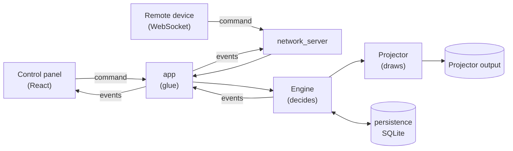

# Architecture

The big idea: **the engine is the single source of truth.** Everything else (the control panel, the stage monitor, remote devices) sends *requests* to the engine and displays the *state* the engine reports back. Nothing else decides what's on screen.

## The pieces

| Piece | Folder | What it does |
|---|---|---|
| **Control panel** | `desktop/crates/app/frontend` | React UI. Sends commands, re-renders from engine events. Holds no state of its own that matters. |
| **app** | `desktop/crates/app/src/main.rs` | The glue. Opens the windows, turns UI button clicks into commands, owns the one database connection, and runs the engine loop. |
| **protocol** | `desktop/crates/protocol` | The shared vocabulary: every command, event and data shape (project, session item, program state). The UI and remote devices speak exactly this, as JSON. |
| **Engine** | `desktop/crates/core_engine/src/engine.rs` | The brain. Takes one command at a time, updates state, reports what changed. Has no idea about windows or GPUs, so it's fully covered by automated tests. |
| **Projector** | `desktop/crates/core_engine/src/projector.rs` | The hands. Draws the scene on the GPU: a background layer (image or video), then a text layer on top. |
| **persistence** | `desktop/crates/persistence` | Saves and loads projects in SQLite. Each project is stored as one JSON document. |
| **network_server** | `desktop/crates/network_server` | WebSocket server for remote control. Currently only reachable from the same machine. |

## What a project looks like

A **project** holds a **session**: an ordered playlist of **items**. Each item is text (a list of *steps*, e.g. song lines), an image, a video, or a presentation (not implemented yet).

The live **program state** says what's on air right now: which item and step is active, which item is next, the text being shown, the background, and play/pause status.

## One click, end to end

1. The operator clicks **Next** → the UI sends the `nav_next` command.
2. The app forwards it to the engine as `Next`.
3. The engine moves to the next step, or to the next item if the current one is finished, and tells the projector to show the new text/background.
4. The engine reports what changed; the app saves that as the latest snapshot and broadcasts it to the UI and any remote devices.
5. The projector redraws.

## Events (what the engine reports)

There are only three:

- **`project_changed`**: the full loaded project (after loading or saving).
- **`program_changed`**: the full live program state.
- **`error`**: a command couldn't be applied (e.g. missing file). Nothing changed.

Each state event contains the **complete** state, so listeners simply replace what they had; there's no patching of partial updates. A `version` number increases with every change. A newly opened window asks for the current snapshot once, then listens for events.

## Drawing

The projector redraws **immediately after any change**, and **every frame (~60/s) only while a video is playing**. Otherwise it does a cheap refresh 4 times a second, in case the window got painted over.

## Not wired up yet (kept on purpose)

- `AudioEngine` (`core_engine/src/audio.rs`): reserved for audio playback and syncing with other projects.
- `desktop/crates/app/src/lib.rs` + the library build settings in `desktop/crates/app/Cargo.toml`: Tauri's scaffolding for non-desktop targets, kept for future web work.

## The song library (cloud side)

Everything above runs on the projection computer. The weekly prep happens in a separate web app (`web/app`) backed by Convex (`web/backend`). The two sides divide the work like this:

| Data | Decided by | Why |
|---|---|---|
| Songs, sections, services, arrangements | **Convex** | Several people edit it during the week, and it must sync instantly |
| What's on screen right now | **The engine** | Next/Prev must never wait on the internet |

The plan for connecting them: the desktop control panel uses the same Convex client as the web app, then hands the service to the engine as a project. The engine caches it in SQLite so the service still runs if the internet drops.

### How the repo is split

`desktop/` and `web/` are independent projects: each has its own lockfile, commands and release. Changing one never requires rebuilding or redeploying the other. The only link between them is the Convex API:

- `web/` never imports anything from `desktop/`.
- When the desktop gets cloud sync, its control panel will import the generated API from `web/backend` (and lyric code from `web/shared`) as a local path dependency.
- The rule for the Convex functions the desktop calls: once a desktop release is out, only add to them (new optional arguments, new functions). Never rename or remove anything a released desktop still uses. Venues update the desktop less often than the web app redeploys.

### Cloud data model

- **songs / sections**: the library. A section is a labelled block of lyrics ("Verse 1"); a blank line inside it is a slide break. A song's *usual order* lists section IDs and can repeat them.
- **services / serviceItems**: a dated service and its songs. Each item has its own **sequence**: the order its sections are sung in for this service.
- A **sequence entry** points at a library section, so library fixes flow into every service automatically. It can also carry its own label/lyrics: that's a *variation* for this service only. "Save to library" promotes a variation; "Use library version" drops it. An entry with no section is a service-only part (a tag added for this week). When a library section or song is deleted, the services that use it get a copy, so they don't lose that part.
- **users** have one role: admin, librarian, leader, operator or singer. What each role may do is one table in `web/backend/convex/lib/auth.ts`.
- **devices**: projection computers. An operator gets a one-time code on the Team tab and types it into the app. The app then works as that operator until removed.

### Why edits are small operations

The song leader on their phone and the operator at the desk may arrange the same service at once. So the server never accepts "here's the whole new list". It only takes operations like "move entry *abc* to position 2" or "remove entry *def*". Convex runs each one as a transaction, one after another, so every person's change lands. This is also why every entry has a stable `key`: a repeated chorus is several entries with the same section, and the key tells them apart.

## Where to change things

| I want to… | Look in |
|---|---|
| Change the control panel | `desktop/crates/app/frontend/src/App.tsx` |
| Add a new command or change a data shape | `desktop/crates/protocol/src/lib.rs`, then the engine, then `main.rs` (UI command) and the frontend |
| Change navigation or other on-air behaviour | `desktop/crates/core_engine/src/engine.rs` (and its tests at the bottom) |
| Change how things look on the projector | `desktop/crates/core_engine/src/projector.rs` and `scene/` |
| Change how projects are stored | `desktop/crates/persistence/src/repo.rs` |
| Change the song library web app | `web/app/src/pages/` |
| Change the cloud data model or server rules | `web/backend/convex/` (schema in `schema.ts`, tests in `services.test.ts`) |
| Change who may do what | `web/backend/convex/lib/auth.ts` |
| Change how pasted lyrics are split into sections/slides | `web/shared/src/lyrics.ts` |
