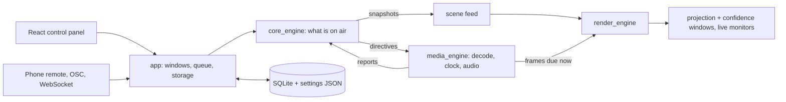

# Architecture

Two apps in one repository: **PALTO** (`desktop/`), run by the operator at the venue, and the **song library** (`web/`), used by the team during the week. The system is offline-first: PALTO runs a whole service from its local library and will sync with the cloud when it can. The network is never on the live path.

## PALTO

The operator works in a React control panel inside a Tauri window. The projection and confidence screens are plain OS windows with **no webview**, drawn by Rust with wgpu. One engine thread decides what is on air; one media session decodes each video once for both screens and owns the only audio output.

| Crate (`desktop/crates/`) | Owns |
|---|---|
| `protocol` | Every command, event and data shape, as JSON. The UI's TypeScript types are checked against it at build time. |
| `core_engine` | The state machine: selection, cues, display modes, media sessions. No GPU, audio or FFmpeg, so it is fully unit-tested. |
| `media_engine` | Decode workers (software or hardware), frame queues, clocks, the audio output, posters. |
| `render_engine` | One GPU device, a presentation thread per output, scenes, text, painting, previews, live monitors. |
| `app` | Tauri: `startup/`, IPC `commands/`, `output/` (windows, displays, scene feed), `input/`, `capture/`, `library/`, `system/` (logs, backups, recovery, updates). |
| `persistence` | SQLite library and services. |
| `network_server` | WebSocket and phone remote on one port, pairing, `palto.local`, OSC. |

### How it behaves

- **One queue.** UI, remote and media reports share one bounded queue. The engine applies at most 64 inputs per publish, merges adjacent seeks, volume changes and saves, and refuses rather than blocks when full.
- **Whole-domain events.** `project_changed`, `program_changed` and `playback_changed` carry complete state with a revision; clients replace, never merge. After falling behind they resync from the snapshot.
- **Sessions and generations.** Every media cue opens a new session and every seek a new generation, so late commands and reports are ignored.
- **Media.** 8-bit 4:2:0 video up to 4K is uploaded as YUV planes and converted on the GPU; other formats are converted by swscale first. Hardware decoding is selectable and falls back to software mid-stream. Loops replay their prepared first frames at the wrap. The audio callback reads a lock-free ring and never blocks; a lost device is retried every 500 ms. The clock follows the audio heard, else a monotonic clock.
- **Prepared cues.** Stills, video first frames and audio for the cues either side are loaded paused, and a cue for the same file adopts them.
- **Scenes.** Pure functions turn engine state and output settings into a main and a confidence scene. Text uses cosmic-text with kerning restored around spaces; shadow, outline and glow come from distance-field glyphs in the same pass. Shader backgrounds render at 960×540 and at most 30 fps, and freeze if they cannot keep up.
- **Outputs** present with vsync on their own threads and redraw only on change. Live monitors are native child windows over the webview, drawn from the same textures at up to 30 fps.
- **Settings.** Unknown fields survive a round trip; an unreadable file is set aside and reported. Media is copied into `media/` on import.

| Display mode | Projection | Confidence | Media |
|---|---|---|---|
| Live | Current cue | Teleprompter, or the video if its Confidence option is on | Continues |
| Clear | Background only | Teleprompter | Continues |
| Black | Black | Teleprompter | Continues |
| Logo | Logo image or looping logo video | Teleprompter | Video pauses and resumes; standalone audio plays on |

### Decisions

1. **Native outputs only, no webview fallback.** Two HTML players drifted, doubled the audio and lagged. If native windows fail somewhere, the alternative is a separate output process, not a webview.
2. **One decoder and one audio output per session**, shared by both screens, which removes drift and double audio by construction.
3. **The engine owns playback state.** Everything else requests and displays.
4. **React for editing and controls only**, off the live path.
5. **Windows 10/11 is the acceptance platform**; development is on Linux under XWayland. Displays on two GPUs are not supported.
6. **Target machine: Ryzen 3 2200G, 8 GB, GTX 1050 Ti.** Features are judged against it. Software decoding stays the default until it is profiled there.
7. **Audio goes to the system default device**, with reconnect; pitch follows speed.
8. **Monitors and previews come from the real renderer**, never a second layout engine or decoder.
9. **Only what the native renderer draws is offered** in the style settings.
10. **Keep the system light:** no unused code or settings, bounded queues, no redraw without a change, no per-frame data through JSON.
11. **Offline-first:** sync feeds the local library and is never needed to run a service; while a service is live, PALTO owns it.

### Known limits

- Kerning around spaces is restored for left-to-right lines only. Color emoji draw as single-color shapes.
- Hardware decoding copies frames back to system memory; 10-bit and 4:2:2/4:4:4 video is converted on the CPU.
- Captures travel through system memory and are capped at 30 fps. X11 capture cannot read the screen under XWayland.
- Only one foreground file is prepared at a time.

### Test aids

`PALTO_DATA_DIR=<dir>` (another data folder), `PALTO_SHOW_OUTPUTS=1` (show outputs at start), `MAGI_TEST_CAPTURE=1` (a test-pattern capture method), `MAGI_OUTPUT_CAPTURE=<dir>` (PNG of each settled output), `WGPU_BACKEND=dx12|vulkan`, `RUST_LOG`. Every 5 s the log has a `profile:` line with per-stage frame timings.

## Song library

A phone-friendly PWA on [Convex](https://convex.dev) with [Clerk](https://clerk.com) sign-in. The lyric team edits songs early in the week, the song leader arranges services, singers read them on the weekend.

- **songs / sections:** a section is a labelled block of lyrics; a blank line is a slide break. A song's usual order lists section ids and may repeat them.
- **services / serviceItems:** each item has its own sequence. An entry points at a library section and can carry a service-only variation.
- **users** have one role (admin, librarian, leader, operator, singer); permissions are in `web/backend/convex/lib/auth.ts`.
- **Edits are small operations** ("move entry *abc* to 2"), each a Convex transaction, so concurrent editors never overwrite each other.

`web/` never imports from `desktop/`. When PALTO syncs, it will import the generated Convex API. After a desktop release, Convex functions may only gain optional arguments or new functions, because venues update less often than the web redeploys.

## Where to change things

| To change | Look in |
|---|---|
| The control panel | `desktop/crates/app/frontend/src/` (`App.tsx` is the layout; folders by area) |
| A command or data shape | `protocol/src/`, then `core_engine`, then `app/src/commands/`, then `frontend/src/api/`; regenerate fixtures |
| Navigation or on-air behavior | `core_engine/src/engine/` (tests in `engine/tests/`) |
| How the screens look | `render_engine/src/` (`main_scene/`, `confidence/`, `text/`, `paint/`) and `app/src/output/scene/` |
| Playback, decoding or audio | `media_engine/src/` (`decoder/`, `audio/`) |
| Output settings fields | `protocol/src/output_config.rs` and `frontend/src/settings/outputState.ts` |
| Keys and controllers | `protocol/src/input.rs` and `app/src/input/` |
| Screen capture | `app/src/capture/` (one file per platform method) |
| Updates and releases | `app/src/system/updates.rs`, `tools/build-windows.sh`, `tools/release.sh`, `.github/workflows/ci.yml` |
| Phone remote, pairing, OSC | `network_server/` (`remote/` is the phone page) and `app/src/remote.rs` |
| The web app or its data | `web/app/src/pages/`, `web/backend/convex/`, `web/shared/src/lyrics.ts` |
