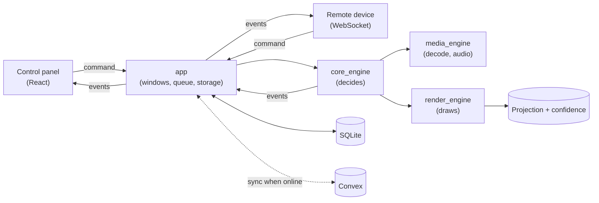

# Architecture

Two apps share one repository: a **projection app** the operator runs at the venue, and a **song library web app** the team uses during the week. The system is **offline-first**: the projection app runs a whole service from its own local library, and syncs with the cloud when a connection is available (planned). The internet is never on the live path.

## Principles

- **The engine is the single source of truth for what is on air.** The control panel, remote devices and the output screens send requests to the engine and display the state it reports. Nothing else decides what is on screen.
- **Local first, cloud second.** Songs, services and media are stored on the projection computer. Cloud sync fills and updates that local copy; a dropped connection never stops a service.
- **Each side owns what it is best at.**

| Data | Owned by | Why |
|---|---|---|
| What is on screen right now | The desktop engine | Next/Prev must never wait on the internet |
| The local library and services the operator runs | Desktop SQLite | The service must run with no connection |
| The shared song library, service plans, team roles | Convex (cloud) | Several people edit during the week and it must sync instantly |
| Media files | The projection computer, synced to Convex storage (planned, up to 100 MB per file) | Played locally; the cloud copy is for sharing and backup |

## The projection app (`desktop/`)

Tauri desktop app: a React control panel plus native GPU output windows. How the outputs, media and engine work, and why, is in [ENGINE.md](ENGINE.md).

| Piece | Folder | What it does |
|---|---|---|
| Control panel | `desktop/crates/app/frontend` | React UI: library, service builder, song editor, cue list, media cards, output settings. Sends commands, re-renders from engine events. |
| app | `desktop/crates/app` | Opens the windows, turns UI calls into commands, runs the engine queue and the storage worker, keeps settings files. |
| protocol | `desktop/crates/protocol` | Every command, event and data shape, spoken as JSON by the UI and remote devices. TypeScript types are checked against it at build time. |
| core_engine | `desktop/crates/core_engine` | The state machine. One command at a time; no windows, GPU or decoders, so it is fully unit-tested. |
| media_engine | `desktop/crates/media_engine` | Video/audio decoding, playback clocks, the single audio output, thumbnails. |
| render_engine | `desktop/crates/render_engine` | Draws the projection and confidence screens and the operator preview stills. |
| persistence | `desktop/crates/persistence` | SQLite: songs, media records, services (each service stored as one JSON document). |
| network_server | `desktop/crates/network_server` | WebSocket remote control; same machine only for now. LAN access with pairing codes, a phone remote and OSC/Companion control are planned (roadmap phases 6 and 9). |

### One click, end to end

1. The operator clicks a lyric line → the UI sends `Cue { item_id, index }`.
2. The app puts it on the engine queue.
3. The engine moves the selection, opens or closes media sessions as needed, and publishes `program_changed` (and `playback_changed` if media changed).
4. The scene feed rebuilds the projection and confidence scenes; each output crossfades to its new scene on its own thread.
5. The UI and remote devices replace their state with the new snapshot; the preview stills refresh once the transition settles.

## The song library (`web/`)

A phone-friendly PWA backed by [Convex](https://convex.dev) (database that pushes changes to every open screen) with [Clerk](https://clerk.com) sign-in.

| When | Who | Where |
|---|---|---|
| Mon–Tue | Lyric team | Library: paste lyrics, fix typos, set the usual order |
| Wed–Fri | Song leader | Services: plan the service, arrange sections, change lyrics for that service only |
| Sat–Sun | Singers | Services (lyrics view): read the arrangement |
| Sat–Sun | Operator | Projection app, running from its local copy |

### Cloud data model

- **songs / sections**: the library. A section is a labelled block of lyrics ("Verse 1"); a blank line inside it is a slide break. A song's *usual order* lists section IDs and can repeat them.
- **services / serviceItems**: a dated service and its songs. Each item has its own **sequence**: the order its sections are sung in for this service.
- A **sequence entry** points at a library section, so library fixes flow into every service. It can carry its own label/lyrics: a *variation* for this service only. "Save to library" promotes a variation; "Use library version" drops it. An entry with no section is a service-only part. When a library section or song is deleted, services that use it get a copy.
- **users** have one role: admin, librarian, leader, operator or singer. Permissions are one table in `web/backend/convex/lib/auth.ts`.
- **devices**: projection computers. An operator gets a one-time pairing code on the Team tab and types it into the projection app, which then works as that operator until removed.

### Why edits are small operations

The song leader on a phone and the operator at the desk may arrange the same service at once. The server never accepts "here is the whole new list"; it only takes operations like "move entry *abc* to position 2". Convex runs each as a transaction, so every change lands. Every entry has a stable `key`, which tells repeated sections (several choruses) apart.

## Sync (planned)

Not built yet; the items and decisions are in [ROADMAP.md](ROADMAP.md#4-cloud-sync-offline-first). The intended design:

1. **Pair** the projection computer once with a code from the web app.
2. **Pull** services, songs and media into the local library whenever online. Library songs are kept as local reference copies; the local copy is complete enough to run any service with no connection.
3. **Run locally.** Cues, media and outputs only ever read local data. While a service is live, the projection computer owns it: the web shows it as "live on site" and holds edits to it until the service ends.
4. **Push** desktop edits as the same small Convex operations the web app uses. They come from the desktop's edit history in SQLite (which also powers undo), are queued while offline, and are sent when the connection returns.
5. **Conflicts never block the operator.** Operations that do not touch the same thing merge automatically. Changes to the same thing on both sides go to a "needs attention" list, settled in a side-by-side dialog when the operator chooses.
6. **Switches (flags)** control costly or chatty updates such as "now showing" for the singers' view. Admins set team defaults on the web and per-computer overrides; the computer keeps its last known switches while offline. A **full offline** setting stops sync entirely.
7. **Media** syncs both ways through Convex storage for files up to 100 MB, identified by content hash; larger files stay local.

### Planned data model change

The library becomes the reference artifact: editing a service never changes the library song. Library fixes reach **upcoming** services but not past ones; per-service variations are never overwritten. Desktop and cloud move to shared string IDs. The cloud model below describes today's web app, where library fixes flow into every service.

## How the repo is split

`desktop/` and `web/` are independent projects: each has its own lockfile, commands and release. Changing one never requires rebuilding or redeploying the other. The only link is the Convex API:

- `web/` never imports anything from `desktop/`.
- When the desktop gets sync, its control panel imports the generated API from `web/backend` (and lyric code from `web/shared`) as a local path dependency.
- Once a desktop release is out, only add to the Convex functions it calls (new optional arguments, new functions). Never rename or remove anything a released desktop still uses: venues update the desktop less often than the web app redeploys.

## Where to change things

| I want to… | Look in |
|---|---|
| Change the control panel | `desktop/crates/app/frontend/src/` (`App.tsx` is the layout; panels and editors are their own components) |
| Add a command or change a data shape | `desktop/crates/protocol/src/lib.rs`, then the engine, then the app command in `main.rs`, then the frontend; regenerate protocol fixtures |
| Change navigation or on-air behavior | `desktop/crates/core_engine/src/engine.rs` (tests at the bottom) |
| Change how the screens look | `desktop/crates/render_engine/src/` (`main_scene.rs`, `confidence.rs`, `text.rs`) and the scene feed in `desktop/crates/app/src/native_scene.rs` |
| Change playback, decoding or audio | `desktop/crates/media_engine/src/` |
| Change output settings fields | `desktop/crates/protocol/src/output_config.rs` and `frontend/src/outputState.ts` |
| Change how songs and services are stored | `desktop/crates/persistence/src/repo.rs` |
| Change the song library web app | `web/app/src/pages/` |
| Change the cloud data model or server rules | `web/backend/convex/` (`schema.ts`, tests in `services.test.ts`) |
| Change who may do what | `web/backend/convex/lib/auth.ts` |
| Change how pasted lyrics are split into sections/slides | `web/shared/src/lyrics.ts` |
