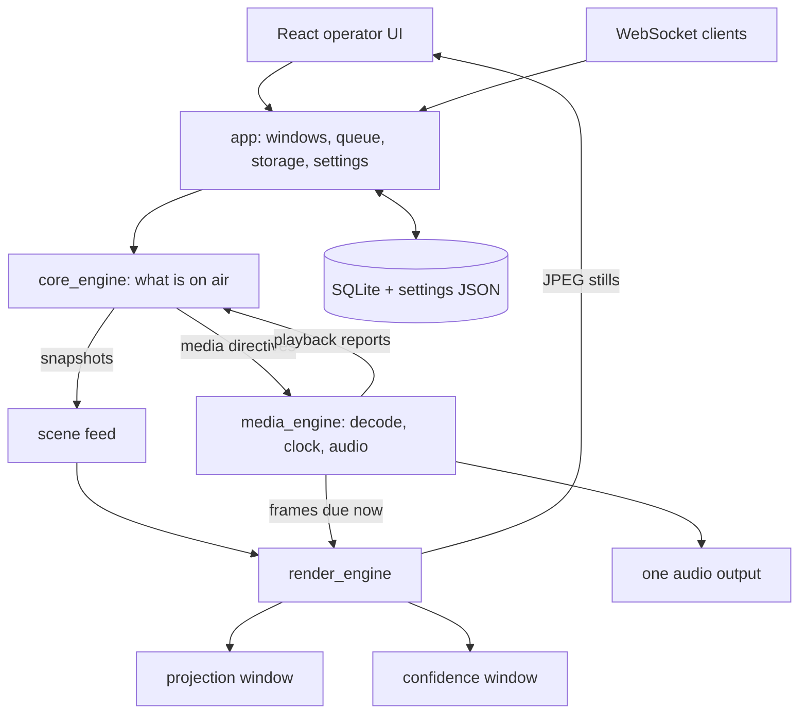

# Output engine

How the desktop app puts lyrics, images, video and audio on the projection and confidence screens, and why it is built this way. For the whole system (desktop, cloud and how they sync) see [ARCHITECTURE.md](ARCHITECTURE.md); for what comes next see [ROADMAP.md](ROADMAP.md). The history of how the engine got here, with measurements and bugs found along the way, is in [docs/records/](docs/records/).

## In one paragraph

The operator works in a React control panel inside a Tauri window. The projection and confidence screens are plain OS windows with **no webview**: Rust draws them with wgpu. One engine thread decides what is on air. One media session decodes each video once for both screens and owns the only audio output. The operator UI never plays media; it shows still previews rendered by the same engine.

## Components

All crates are under [desktop/crates/](desktop/crates/).

| Crate | Owns | Never owns |
|---|---|---|
| `protocol` | Every command, event and data shape (projects, songs, program and playback state, output settings). Serialized as JSON for the UI and WebSocket. | GPU handles, frames, windows. |
| `core_engine` | The state machine: selection, cues, display modes, media sessions and their generations, song normalization (`magi.song.v1`). Builds and tests without GPU, audio or FFmpeg. | Rendering, decoding, platform event loops, blocking I/O. |
| `media_engine` | Demux and decode workers, bounded frame queues, transport, playback clocks, the audio output, poster thumbnails. | Windows or layout. |
| `render_engine` | One GPU device, a presentation thread per output, scene layout (main and confidence), text shaping, painting, still previews. | Decoders or audio. |
| `app` | Tauri integration: windows, operator commands, the bounded engine queue, the storage worker, settings files, wiring the crates together. | A second idea of what is on air. |
| `persistence` | SQLite library and services (schema v2). | Runtime state. |
| `network_server` | WebSocket remote control with the same commands and events as the UI. | Its own transport logic. |
| React frontend | Editors, operator layout, transport buttons, preview stills, errors. | Playback, audio, frame timing. |

## Engine and commands

- **One queue.** UI commands, WebSocket commands and media reports share one bounded queue ([engine_host.rs](desktop/crates/app/src/engine_host.rs), 1024 entries). The engine applies at most 64 inputs before publishing, so continuous input cannot delay a cue. Adjacent seeks, volume changes, reports and saves of one project coalesce. A full queue returns an error to the caller instead of blocking.
- **Ports.** The engine talks to the world through three small traits: `Assets` (checks a background file before switching to it, so a missing file is reported and the previous background stays), `MediaBackend` (receives `MediaDirective`s) and `ProjectStore`. Tests use fakes for all three.
- **Typed media transport.** `EngineCommand::Media { session_id, action }` covers play, pause, stop, seek, volume, mute, rate, loop and clip bounds. Every cue that plays media opens a new session; every seek starts a new generation. Commands for an old session and reports from an old session or generation are ignored, so a late reply can never bring back an old cue.
- **State domains.** `project_changed`, `program_changed` and `playback_changed` each carry the complete state of their domain with their own revision; listeners replace what they had. `error` reports a refused command. Playback progress is published at a bounded rate; rendering and the audio clock never depend on it.
- **Saving.** The engine accepts a save immediately; a storage worker writes saves in order and merges adjacent saves of one project. A load waits for queued saves. A failed save is reported, not rolled back.
- **Remote.** The WebSocket server subscribes before sending its snapshot, resends the full snapshot after falling behind, and binds `127.0.0.1` by default.

### Display and media policy

| Action | Projection | Confidence | Media |
|---|---|---|---|
| Live | Current cue | Teleprompter, or the cued video if its Confidence option is on | Continues |
| Clear | Background only, no lyrics | Teleprompter | Continues |
| Black | Black | Teleprompter | Continues (Pause or Stop to silence) |
| Logo | Logo image or muted looping logo video | Teleprompter | Video pauses and resumes where it was; standalone audio keeps playing |
| Leave a media cue | Next cue once it is ready | Next scene | The old session closes exactly once |

A song's own background carries over to items without one; a foreground video or image never becomes the next song's background.

## Windows and GPU

- Outputs are Tauri windows built with no webview (Tauri `unstable` feature). Tauri's event loop is the only event loop.
- One wgpu 30 device (DirectX 12 or Vulkan, high-performance adapter) is shared by both outputs; each output presents from its own thread with Fifo (vsync). A slow or covered output never blocks the other.
- Surfaces are configured inside an error scope and retried; an output draws only once its surface matches its size, and reconfigures after a suboptimal present.
- Linux: the app forces `GDK_BACKEND=x11` (XWayland), because GTK and Vulkan both committing to one Wayland surface is a protocol error. Output windows are app-paintable so GTK never paints its theme background over a frame.
- Display assignments and fullscreen choices are saved per output by display identity; a missing display stays saved and shows as disconnected.

## Media

- **One decoder per session.** A worker thread demuxes the file and decodes video and audio. Video becomes RGBA, scaled down to fit 1920×1080 (never up). Timestamps are normalized to the container start; decoders are drained at end of file.
- **One texture per source.** The renderer's frame pump asks the session for the frame due now and uploads it once; both outputs sample it. Turning on a video's Confidence option adds no decoder and no audio.
- **Ambient sessions.** Song and Logo video backgrounds are muted looping sessions keyed by file. They decode no audio and survive lyric changes while the file stays the same.
- **One audio output.** A CPAL stream on the system default device, opened once for the app's lifetime. Its callback reads a lock-free ring (1 s) and never decodes, allocates or blocks. After a device error it retries the default device every 500 ms and converts rate and channels if the new device differs; the media card shows "reconnecting" meanwhile.
- **Clock.** With audio: the samples the device has been handed, projected to its playback timestamp. Without audio: a monotonic clock anchored at the transport position. During an underrun the clock holds rather than running ahead.
- **Rate.** 0.5–2×; pitch follows rate (audio is resampled).
- **Seek, stop, loop.** Each restart gets an epoch; queued audio and frames are flushed and the current frame stays up until the new epoch's first frame, so there is no black gap. Clip bounds are `[start, end)`. Looping seeks to the clip start; it is not guaranteed seamless.
- **Backpressure.** The frame queue holds 6 frames chosen by presentation time. Video packets are stashed (up to 64 MB) so audio never waits behind video, and frames the clock has passed are dropped, so a throttled output never slows decoding.
- **Preload.** Opening a session decodes the first frame and fills the audio ring while paused. Nothing is audible until play.
- **Posters.** Thumbnails are the first frame, 640 px wide, decoded in-process and cached as JPEG. No `ffmpeg` executable is needed; the app links only `avcodec`, `avformat`, `avutil`, `swresample` and `swscale`.

## Scenes

- **Scene feed** ([native_scene.rs](desktop/crates/app/src/native_scene.rs)). Pure functions turn program state, the project, playback and output settings into a `MainScene` and a `ConfidenceScene`. A feed thread rebuilds them on every engine event and settings save, sends only what changed, and keeps exactly the needed ambient videos open.
- **Readiness.** A new background, logo or confidence video appears only once it has pixels, then crossfades over the configured transition while the previous one stays up. A file that never loads leaves the previous background, never a black frame.
- **Lyrics.** Outgoing and incoming text crossfade on one clock; the box fill and border stay up through the fade. Rapid cues keep only the newest text plus one outgoing.
- **Text** ([text.rs](desktop/crates/render_engine/src/text.rs)). cosmic-text shaping with font fallback and bidi. Supported style: font family, weight, italic, caps, color, size, line height, letter spacing, alignment, vertical placement, safe margins, and the border card (border width and color, box fill and opacity). Missing families resolve through fontconfig on Linux and to Arial / Times New Roman / Consolas on Windows.
- **Painting** ([paint.rs](desktop/crates/render_engine/src/paint.rs)). One instanced pipeline for fills, images and glyph masks, with scissor clipping and rotation. Blending happens on sRGB values, as browsers do.
- **Confidence** ([confidence.rs](desktop/crates/render_engine/src/confidence.rs)). HH:MM clock from local time, arrangement tape (current card outlined, past cards desaturated), sticky rotated part labels, active and past rows, smooth scrolling that centers the active row. Layouts are cached per scene and size and rebuilt on a worker; only the visible neighborhood is drawn.
- **Redraw policy.** An output presents only when its scene, size, a transition or a visible video changes. Idle outputs check for pending media every 16 ms without redrawing.
- **Previews** ([preview.rs](desktop/crates/render_engine/src/preview.rs)). A low-priority thread renders each scene once its transitions settle (or after 3 s), up to 1920 px wide, and scales it to a 640 px JPEG. The UI fetches the bytes with `get_output_preview` after an `output:preview` event; no image passes through JSON. Previews of video show the frame current when the scene settled and open no decoder.

## Settings and data

- Library and services: `app.db` (SQLite) in the OS app-data folder (`com.magi.projection`; an existing `com.tauri.dev` library stays in use).
- `output-settings.json`: typed as `protocol::OutputConfig`. Missing fields take defaults; fields this version does not know (from newer versions, or outline/shadow/glow from older ones) survive a round trip. Saved atomically; an unreadable file is kept as `*.invalid-<ms>.json` and reported.
- `output-displays.json`: display assignments and fullscreen choices. `app-config.json`: WebSocket host/port and the last projection window size.
- `session-state.json`: crash recovery. Marked running from start to a clean exit, with the current service, item and step. A start that finds it still running reopens that cue with media paused and outputs hidden; if the run that restored a cue crashes again before moving on, the next start does not restore it again.
- `logs/`: `pakit.log` and up to four rotated files. The displays are kept awake while any output is shown (`SetThreadExecutionState` on Windows, the `org.freedesktop.ScreenSaver` idle inhibitor on Linux).
- Media is referenced by absolute path. Imports (library media, presentation images, the logo) copy the file into `media/` first, reusing an identical file; older media still points at its original location until the phase 3 migration moves it in. Relinking rewrites matching paths in the media table, every service (including song documents inside items), library songs and the logo; the loaded service is saved through the engine. *Next (roadmap phase 3): IDs become strings shared with the cloud, and every edit is kept in an edit history that powers undo and sync.*
- Output styling is shared by both screens except the confidence text size. *Next (phase 5): each screen gets its own parameters and a redesigned settings page.*

## Decisions

Settled 2026-10-10 and revised 2026-10-11. Each says why.

1. **Native outputs only, no webview, no fallback.** Two HTML video players could not be kept in sync, audio was duplicated, and the webview outputs lagged. The native outputs are tested and working on Omarchy Linux and Windows 10, so the webview backend was removed rather than kept as a fallback. If native windows ever fail on a platform, the reviewed alternative is a separate output process over local IPC, not a webview.
2. **One decoder and one audio output per session, shared by both screens.** This removes the drift between screens and the double audio by construction, instead of correcting it afterwards.
3. **The engine owns playback state.** Outputs and the UI report and request; they never decide. One state machine with session and generation IDs makes stale or out-of-order input harmless.
4. **React stays for editing and controls.** It is the fastest way to build the operator UI, and it is off the live path: a slow UI cannot disturb the outputs, which present from their own threads.
5. **Platforms.** Develop on Omarchy Linux (Hyprland, run under XWayland). Users run Windows 10/11, which is the acceptance platform. Displays attached to different GPUs are not supported.
6. **Target hardware: Ryzen 3 2200G, 8 GB RAM, GTX 1050 Ti (4 GB).** Features are judged against this machine. CPU decode plus RGBA upload is the measured baseline (about 27% of one core for 1080p on a Ryzen 5 5500U); hardware decoding comes after profiling on the target (roadmap phase 7), as a selectable option with software decoding as the fallback.
7. **Audio uses the system default device** with automatic reconnect. Venue routing is done in the OS sound settings, which operators already know. Pitch follows rate because it is the simplest correct behavior.
8. **Display policy as in the table above.** Logo is a picture override, so it pauses video but not walk-in music; Black and Clear keep transport running so the operator controls audio explicitly; a previous video never silently becomes a background.
9. **Previews are still images from the real renderer.** No second layout engine to keep in step and no second decoder; low frequency keeps the operator light.
10. **Minimal text styling.** Only what the native renderer draws is offered. Outline, shadow and glow were removed from the settings rather than left as controls that do nothing. They return per screen in roadmap phase 5: shadow as a blurred glyph pass, outline and glow through signed-distance-field glyphs.
11. **Keep the system light.** No unused ports, commands or settings in the code. Bounded queues everywhere, nothing redrawn without a change, no per-frame data through JSON.
12. **Offline-first.** Everything on air runs from the local SQLite library; nothing on the live path waits on the network. Cloud sync (planned, see ARCHITECTURE.md) feeds the local library and is never required to run a service; while a service is live, the projection computer owns it.

## Known limits

- Kerning pairs that include the space character are lost (cosmic-text shapes word by word); a few pixels in some fonts. *Phase 5: shape whole lines.*
- Color emoji render as single-color shapes. Not planned; an icon set drawable on the outputs is (phase 5).
- The next cue is not prepared ahead of time; images load on cue and logo videos start when Logo is pressed, so they fade in after a short decode delay. *Phase 5: prepare the next and previous cues.*
- Lyrics only crossfade. *Phase 5: cut and slide, with duration, easing and direction.*
- When both output windows are covered, uploads wait behind their throttled presents and update about once a second; one visible output still runs at full rate.
- Looping is not measured as seamless. *Phase 7: prepare the loop point.*
- Windows items still to check on the church PC are in [WINDOWS.md](WINDOWS.md).

## What comes next for the engine

From [ROADMAP.md](ROADMAP.md), the parts that change this document:

- **Phase 5, looks:** per-screen parameters, text shadow, outline and glow, transition styles, shader backgrounds with built-in presets and hard resource limits (frame rate and resolution caps, automatic fallback to a still).
- **Phase 6, operator controls:** one input layer for keyboard bindings, presenter clickers, MIDI, Stream Deck and OSC/Companion, all sending the same engine commands.
- **Phase 7, media:** profiling on the church PC, YUV upload with shader conversion, selectable hardware decoding (D3D11VA, DXVA2, NVDEC, QSV, AMF on Windows; VA-API, VDPAU, NVDEC, Vulkan Video on Linux).
- **Phase 8, screen capture:** a window or screen as an output source, captured once for both screens, with the capture API chosen per platform and switchable; a feed from another device's browser over WebRTC, with its audio through the one audio output.
- **Phase 9, presentations:** web pages (the Canva player and other browser presentations) rendered off screen and shown as a source, so the outputs stay native; PDF and PowerPoint as slides.

## Checking it

| What | How |
|---|---|
| All Rust tests (engine, media with generated clips, offscreen scenes, protocol fixtures) | `cargo test --workspace` in `desktop/` |
| UI build, lint and tests (fails if Rust protocol and TypeScript types disagree) | `bun run build && bun run lint && bun run test` in `desktop/crates/app/frontend` |
| Regenerate protocol fixtures after a wire change | `UPDATE_PROTOCOL_FIXTURES=1 cargo test -p protocol --test typescript` |
| Output parity against frozen references (needs ImageMagick) | `desktop/tools/parity/run.sh` |
| Save a PNG of each output when its scene settles | `MAGI_OUTPUT_CAPTURE=<dir>` |
| Simulate a slow confidence output | `MAGI_CONFIDENCE_STALL_MS=<ms>` |
| Run the ignored media repro against a real file | `MAGI_MEDIA=<file> cargo test -p media_engine -- --ignored paused_seek` |

Every 5 s the app logs active decoders, opened audio outputs, frames presented and late, audio underruns and device reopens. Logs go to stderr and to `logs/pakit.log` in the data folder (5 × 5 MB, rotated); `RUST_LOG` sets the filter.

| Test aid | What it does |
|---|---|
| `PAKIT_DATA_DIR=<dir>` | Uses `<dir>` as the data folder (library, settings, logs) |
| `PAKIT_SHOW_OUTPUTS=1` | Shows the outputs at startup, as the Show button would |
| `bun tools/e2e/e2e.ts` | End-to-end WebSocket check against a scratch data folder (cue, navigation, display modes, transport, save, restart and crash recovery) |
| `bun tools/e2e/soak.ts --video <file>` | 30-minute soak: looping video with confidence; fails if memory, decoders or audio outputs grow or frames stop |
