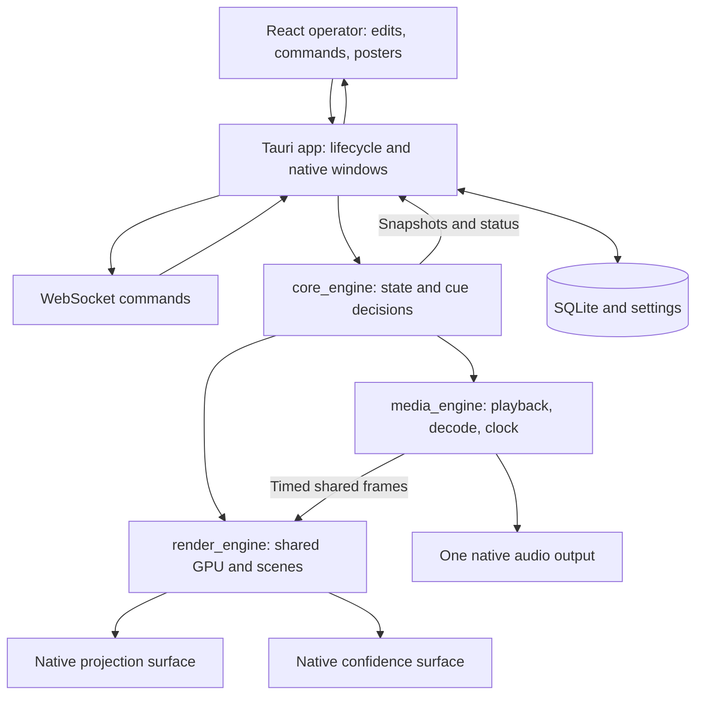

# Native output engine scope

Status: proposal for review, not an implementation commitment. Repository audit: 2026-10-10. This document describes the current working tree, including the recent MVP changes; it does not assume the older architecture notes describe the running application.

The proposed change keeps the React operator UI and replaces **both projection and confidence output webviews** with native output surfaces. One Rust playback session supplies video frames and timing to both surfaces and owns audio exactly once. The confidence teleprompter is a different scene rendered by the same infrastructure.

## 1. What this migration should achieve

- Stable video on projection and optional confidence without synchronizing separate HTML video players.
- One audio output for foreground video/audio; confidence and ambient backgrounds never create another audio stream.
- Responsive lyric cues, simultaneous outgoing/incoming main-text fades, and smooth confidence movement.
- Preserve song/service editing, media cards, saved video options, image presentations, output settings and monitor assignments.
- Keep video decoding, full-rate compositing and playback timing out of the operator webview.
- Establish explicit ownership of windows, GPU resources, decoder workers, clocks and playback state.

Native rendering provides control over these behaviors; it does not itself guarantee lower CPU usage, hardware decoding, zero-copy frames, or physically synchronized monitor scanout. Those claims require measurements.

### Included in the first complete migration

Local images, foreground video with audio, standalone audio, image-group presentations, image/video logos, muted looping song backgrounds, main lyric styling, confidence teleprompter, optional confidence video, transport controls, monitor persistence, resize handling, errors, shutdown and packaged Linux/Windows validation.

### Deferred

Cloud synchronization changes, PowerPoint/PDF conversion, OBS outputs, network video streaming, live capture, multi-machine synchronization, genlock, HDR, a general timeline editor, and hardware decoding/zero-copy optimization. macOS requires a separate validation pass before claiming support; existing bundle configuration is not proof of platform support. Do not upgrade all graphics/media dependencies as part of the migration unless a specific integration gate requires it.

## 2. Repository findings

Paths below are relative to the repository root.

| Area | Current implementation | Migration consequence |
|---|---|---|
| Desktop windows | [app/src/main.rs](desktop/crates/app/src/main.rs) creates projection and confidence with `WebviewWindowBuilder`; `main` is the operator label. | The main projector is also a webview today. Both output windows must change. |
| State machine | [engine.rs](desktop/crates/core_engine/src/engine.rs) resolves selections, text, backgrounds, image-presentation steps and display overrides; tests use fake output/storage. | Preserve navigation and atomic `Cue { item_id, index }`; retain independently testable engine decisions. |
| Output adapter | [projector.rs](desktop/crates/core_engine/src/projector.rs) validates files; drawing, opacity changes and resize are effectively no-ops. | Native drawing is not active. Do not treat this adapter as a functioning renderer. |
| Native GPU scaffolding | [render.rs](desktop/crates/core_engine/src/render.rs), [scene/](desktop/crates/core_engine/src/scene/), [quad.wgsl](desktop/crates/core_engine/src/quad.wgsl), [animation.rs](desktop/crates/core_engine/src/animation.rs). | Reuse audited texture/quad, glyph atlas and animation ideas. Refactor ownership for multiple surfaces. |
| Native video scaffold | [video.rs](desktop/crates/core_engine/src/video.rs) decodes to CPU RGBA, sleeps 30 ms per frame, loops automatically, uses an unbounded queue and drains to the newest available frame. | Replace scheduling/control and queue design. It has no frame timestamps, proper transport, audio synchronization, cancellation/join lifecycle or configurable clip handling. |
| Native audio scaffold | [audio.rs](desktop/crates/core_engine/src/audio.rs) opens a Rodio stream and exposes an atomic time value; `play_dummy` is unfinished. | A functioning native audio pipeline and clock still need implementation. |
| Main output behavior | [ProjectionSurface.tsx](desktop/crates/app/frontend/src/ProjectionSurface.tsx) and [ProjectorVideo.tsx](desktop/crates/app/frontend/src/ProjectorVideo.tsx). | These are the behavior reference for fades, persistent text boxes, media readiness, fitting, logo and video playback. |
| Confidence behavior | [ConfidenceScreen.tsx](desktop/crates/app/frontend/src/ConfidenceScreen.tsx), [ConfidenceVideo.tsx](desktop/crates/app/frontend/src/ConfidenceVideo.tsx), [videoSync.ts](desktop/crates/app/frontend/src/videoSync.ts). | Rebuild the teleprompter scene. Retire follower-player synchronization when both outputs share native playback. |
| Video transport/state | `control_video` emits string actions directly to output webviews; `set_output_state` accepts generic JSON playback reports from the main video element. | Video transport bypasses `EngineCommand`. Rust currently stores reported playback state rather than owning playback. Unify this authority. |
| Standalone audio | [ScheduleAudio.tsx](desktop/crates/app/frontend/src/ScheduleAudio.tsx) uses an operator `<audio>` element. | Move audio decoding/output into the same native playback service; removing output videos alone does not finish media ownership. |
| Protocol | [protocol/src/lib.rs](desktop/crates/protocol/src/lib.rs) defines projects, commands/events and persisted `VideoOptions`. | Extend additively; separate media transport from the existing ambiguous timeline transport fields. |
| Songs | [song.ts](desktop/crates/app/frontend/src/song.ts) parses `magi.song.v1`, repeated arrangements, legacy songs and slide boundaries. Rust stores `song` as a JSON string plus flattened text steps. | Native confidence needs a normalized, labelled arrangement model; flattened steps alone lose the part layout. |
| Persistence | [repo.rs](desktop/crates/persistence/src/repo.rs) stores service JSON and song/media records in SQLite, schema version 2. | Retain existing libraries and IDs. Native runtime objects must never enter saved service JSON. |
| Settings/routes | `main.rs` persists `output-settings.json` and `output-displays.json`; [outputState.ts](desktop/crates/app/frontend/src/outputState.ts) defines styles in TypeScript. | Introduce Rust-owned typed settings, preserve existing fields/defaults, and adapt routing to native windows. |
| Browser media bridge | [media_server.rs](desktop/crates/app/src/media_server.rs), [useMediaUrl.ts](desktop/crates/app/frontend/src/useMediaUrl.ts), [useVideoPoster.ts](desktop/crates/app/frontend/src/useVideoPoster.ts). | Native playback reads local files directly. Retain thumbnails and temporary fallback streaming until webview playback is retired. |
| Remote control | [network_server/src/lib.rs](desktop/crates/network_server/src/lib.rs) receives `EngineCommand` and sends engine snapshots/events. | Use the same typed media commands/events as local controls; do not create another transport implementation. |
| Web application | `web/app`, `web/backend`, `web/shared` form the separate preparation/cloud application. | No cloud schema or deployment changes are required for native output. Preserve that boundary. |

The audited workspace resolves wgpu 22.1.0, glyphon 0.6.0, winit 0.30.12, FFmpeg bindings 8.1.0, CPAL 0.15.3, Rodio 0.19.0 and Tauri 2.11.1. Dependency presence is not evidence that the native pipeline is complete.

### Specific traps in the existing scaffolding

1. `GraphicsEngine::new` creates its own adapter/device/queue and text resources for one surface. Constructing it twice as-is would not share textures across outputs.
2. `VideoNode` owns a `VideoPlayer`. Two nodes constructed independently would start two decoders. Move playback ownership above scene nodes.
3. `VideoFrame` has no PTS, duration, generation or stride. The decoder copies `data(0)` while the uploader assumes tightly packed `width * 4` rows. Handle FFmpeg row stride explicitly.
4. `TextNode` currently uses fixed metrics, position and white text. It does not implement the operator's full font, outline, shadow, glow, alignment, margins and persistent box settings.
5. `EngineCommand::Seek` changes `time_ms` and emits a not-implemented warning. Engine play/pause flags also do not control the HTML media transport. Wire actual playback before considering these commands complete.
6. The engine's `Output` trait only exposes text/background/opacity/one resize. It cannot express independent output scenes, media sessions, readiness or playback acknowledgements.
7. `run_engine` uses an unbounded command channel, drains command bursts and performs storage operations synchronously. Keep decoder work, GPU waits and database latency off the eventual live presentation path; bound batching so continuous input cannot starve cues.
8. Current background state can carry into subsequent items. A previous foreground video can become an implicit song background. Define the intended carryover policy explicitly rather than reproducing this accidentally.
9. The app currently forces X11 in its development script. Linux Wayland behavior is unproven. Window ownership and event-loop integration must be demonstrated early.
10. [ARCHITECTURE.md](ARCHITECTURE.md), [task.md](task.md) and `frontend/public/projection.html` contain older descriptions of active native drawing or incomplete features that no longer match the current runtime. Update them at cutover, not as evidence of completed work.

## 3. Proposed ownership and crate boundaries



Recommended end state:

| Component | Owns | Must not own |
|---|---|---|
| `protocol` | Serializable commands, state, styles, output roles and errors. | GPU handles, decoded frames, OS windows. |
| `core_engine` | Selection, display policy, normalized service/scene intent, media session IDs, state versions. | Rendering loops, blocking decode, platform event loops. |
| New `media_engine` crate | Demux/decode workers, bounded queues, transport, audio sink, master clock, prepared assets. | Per-monitor playback or UI layout. |
| New `render_engine` crate | Shared device/resources, per-output surfaces, scene layout/compositing, render scheduling. | Independent video decoders or audio devices. |
| `app` | Tauri integration, native window handles, runtime coordination, settings/storage adapters and event delivery. | A second interpretation of media transport. |
| React frontend | Editors, operator layout, controls, static previews and error/status presentation. | Real playback, audio output, synchronization or frame scheduling. |

The two new crates are proposed boundaries. Initial modules can be extracted from `core_engine` without a large rewrite, but the state machine should eventually build/test without requiring GPU/audio/FFmpeg initialization.

### Window integration gate

Prefer native windows managed through Tauri's existing desktop runtime, with **no webview attached to either native output surface**. Prove handle access, lifetime, UI-thread requirements and wgpu surface creation against the pinned dependencies. Do not assume the current `WebviewWindow` can safely serve as the native output host.

There must be one application event-loop owner. Do not launch a competing winit event loop on an arbitrary worker thread. If Tauri-native window integration fails on a required platform, stop and review the alternative: a dedicated native output process owning both windows, connected over local IPC. That alternative needs explicit lifecycle, reconnect, crash recovery and frame-transfer design; it is not a silent substitution.

A native window may have exactly one compositor owner. The earlier native/webview overlap is specifically excluded.

## 4. Playback, timing and rendering design

### Shared playback session

A foreground video has one `PlaybackSessionId` and one demux/decode pipeline serving both output scenes. Confidence subscribes to the session's frames; enabling it must not create another decoder or audio stream. GPU presentation remains per output.

Ambient song/Logo video is a distinct muted session with its own loop clock. If the same file is used as foreground and ambient with different positions, those are legitimately different sessions. Reuse by session identity, not file path alone. Preserve an ambient session across lyric changes when its configuration is unchanged.

Prepare the next likely media cue off the live path. Preload decoded frames/metadata without starting its audio. Bound the number of prepared sessions and their byte budgets; replacing a pending cue cancels obsolete work.

### Clock and audio

Use one clock authority per playback session. For audible foreground media, derive presentation position from audio scheduled for device playback, accounting for backend latency; do not use decoder progress, wall-clock polling, or a sample counter that merely counts data enqueued. For silent media use a monotonic clock anchored to transport position. The confidence HH:MM clock is separately derived from local wall time.

Recommended audio backend investigation: CPAL output with a bounded PCM ring buffer and an explicit resampling/rate policy. The callback must not decode, allocate large buffers, acquire contended locks or access storage. Validate device timing support and latency on the supported platforms. Keep Rodio only if the integration spike proves the required clock and control semantics; opening a stream is insufficient.

Pause freezes the session clock. Seek/stop/loop establish a new clock anchor and flush obsolete audio and video. Rate changes affect the clock, video scheduling and audio processing together. Preserve the current 0.5–2× controls; choose and document whether pitch changes or is preserved before audio implementation. Account for underruns with defined clock behavior and telemetry.

Only the audio service owns an output stream. Confidence has no audio sink, volume or unmute command. Background/Logo sessions do not decode audio unless another explicit role requires it. Standalone audio uses this same service, replacing the operator `<audio>` element.

### Decoded frames and seeking

Frames need session ID, generation, normalized presentation timestamp/duration, dimensions, pixel format, row stride and shared buffer ownership. Preserve stream time-base information and normalize nonzero/negative start timestamps. Drain delayed decoder frames at EOF and handle reordered frames.

Use bounded, cancellable queues. Select frames by presentation time; retain the current frame if the next is early and discard genuinely late video frames. Do not drain blindly to the newest decoded frame. Audio and video need different backpressure policies.

Every seek/replacement has a generation ID. Clear packet/frame/PCM queues, flush decoders, seek to an appropriate keyframe, decode forward to the requested time, then present only frames from the current generation. Rapid scrubbing may coalesce to the latest seek; obsolete completion must never restore an old cue.

Treat clip bounds as `[start, end)`, with omitted end meaning EOF. Clamp to probed duration, reject empty/reversed clips, seek to start on stop, and apply the same bounds to audio and both video outputs. Seamless looping requires preparation at the loop point; a simple EOF seek may have a visible gap and must not be described as seamless without testing.

### GPU resources and scheduling

Split the existing `GraphicsEngine` into shared GPU resources and per-surface presentation state. On a compatible adapter, upload each selected decoded frame once and sample the same texture on both surfaces. Surface formats, dimensions, viewport and present settings remain independent. Text atlas resources may be shared where compatible, but preparing one output must not invalidate another output's pending glyph data.

A single GPU device is conditional on adapter/surface compatibility. If displays require different devices, either report that configuration as unsupported initially or add per-device uploads while retaining one decoder/clock. Do not promise a shared GPU texture across incompatible devices.

Render on cue/style/size changes and while video or transitions are active. Schedule clock text updates when needed. Avoid continuous full-rate redraw for static output. Do not hold the engine lock across a vsync/surface acquisition; a slow/minimized confidence surface must not block the projector. The integration spike must demonstrate how surface acquisition/presentation is scheduled independently.

Handle zero-size/minimized outputs, scale-factor changes, Lost/Outdated/Timeout surfaces, device loss, display removal and shutdown. Release acquired surface textures before reconfiguration. Keep the last valid content when possible; expose a recoverable failure rather than panic or reset the service selection.

Start with bounded CPU decode and explicit packed RGBA uploads for a measured baseline. Fix stride, color-space and alpha handling. Add YUV shader conversion/hardware decoding later only if profiling justifies it. Avoid full-frame pixel copies through JSON or frontend events.

### Readiness and transitions

Separate requested cue, prepared cue and presented cue. A loading/failed asset must not produce a black intermediate frame or combine new lyrics with an unrelated background. Commit a prepared scene atomically; failures retain the previous presented scene and report the requested cue's error. The operator should distinguish pending from on-air selection.

Use one monotonic transition start time for outgoing/incoming main text. Keep box fill and border persistent while glyphs crossfade; changes to box styling/geometry need an explicit interpolation policy. For video/image transitions retain the outgoing frame until the incoming frame is upload-ready. Foreground audio must have a defined fade/stop policy when leaving a cue, independent of visual layer disposal.

Confidence uses the same cue revision but a different transition: animated teleprompter movement or a crossfade to the shared video texture. No follower HTML video, periodic seeking or playback-rate correction is needed in the final design. Independent monitors have independent refresh phases; sharing a clock does not provide hardware genlock.

## 5. Scenes and behavior parity

### Main scene

Implement images/presentations, foreground video, muted cover-fit song backgrounds, contained image/video logos, Black/Clear/Live/Logo overrides and the existing main text style settings. The first native release ports a reduced text style set (decision 8): installed font selection/fallback, color, size, line spacing, letter spacing and the border card (box fill, border and opacity), plus the wrapping, alignment and safe margins needed to place text. Outline, shadow and glow are deferred; existing saved values for them are preserved but not rendered natively. Cache shaping/layout; do not rebuild the whole scene for each video frame.

Define style units in Rust and map the existing percentages to them. Test against captured current outputs at multiple aspect ratios; CSS viewport units are not directly native pixel metrics. Native text effects beyond the current `TextNode` will require additional rendering passes/shaders or an equivalent implementation.

### Confidence scene

Preserve the current teleprompter: local HH:MM clock, arrangement tape, part labels/colors, repeated occurrences, muted past sections, active slide and smooth movement. Clip to the viewport and lay out only the visible neighborhood for long services. Resize should retain active-slide focus.

Parse `magi.song.v1` into a normalized model in Rust, preserving legacy single-line slides, blank-line splitting, stored `slideTexts`, arrangement repeats, section colors/codes and occurrence identity. Use `(item_id, arrangement_occurrence, slide_index)` for scene identity. Verify parity using the existing song tests plus shared fixtures; avoid maintaining two divergent layout inputs.

When the current video's `confidence` option is enabled, render its shared texture fullscreen with aspect-correct fitting. When disabled, retain the normal confidence scene. The operator confidence preview remains a poster for video.

### Display and transport policy requiring review

Keep selection separate from display overrides and media transport. Proposed defaults:

| Action | Main output | Confidence | Media policy |
|---|---|---|---|
| Live | Current program scene. | Teleprompter or enabled shared video. | Foreground continues/resumes according to transport. |
| Clear | Background/video, no main lyrics. | Teleprompter, matching the current override behavior. | Transport continues. |
| Black | Black audience scene. | Teleprompter. | Transport continues; use Pause/Stop to silence. |
| Logo | Image or muted looping logo video. | Teleprompter. | Suspend foreground playback; preserve its position for return to Live. |
| Leave foreground cue | New ready scene. | New confidence scene. | Stop/fade the old foreground audio exactly once. |

Logo suspension/resume is an explicit proposed improvement: current webview disposal can stop/recreate the foreground player. Review this behavior before implementing it. Also decide whether backgrounds carry across songs lacking an explicit background; recommendation: preserve an intentional song background, never silently convert a previous foreground video into one.

## 6. Commands, state and persistence

Introduce typed media commands through `protocol` and one runtime coordinator. Proposed vocabulary: media play/pause/stop/seek, set volume/mute/rate, update clip/loop options, set output config and place output. Names are illustrative; do not add a second state machine alongside existing transport without a migration plan.

Commands should address an item/session ID and expected generation where relevant. A stale command for a previous session must be ignored or rejected, even when the same file path is reused. Continuous seek/volume updates may coalesce; cue/stop/project operations retain ordering. Give local and WebSocket callers equivalent validation and semantics.

Keep transport status separate from persisted service metadata. Publish typed playback status: session/generation, requested and presented cue revisions, phase (`preparing`, `ready`, `playing`, `paused`, `ended`, `failed`), position/duration, rate/volume/mute, clip bounds and structured errors. Publish state changes immediately and playback progress at a bounded operator rate, approximately 4–10 Hz; rendering and the audio clock never depend on this reporting frequency.

Keep the existing full-domain snapshot/version convention. Add separate playback/output status revisions instead of emitting the full project every frame. On connect/reconnect, clients need all authoritative domains, including playback and output sizes. Review the existing WebSocket subscribe/snapshot ordering and lag recovery while adding these domains; its current lag branch drops events without actively resynchronizing.

Replace generic JSON output configuration with versioned Rust types and validation. Preserve the existing `VideoOptions` field names/defaults: `confidence`, `looping`, `start_ms`, `end_ms`, `volume`, `rate_percent`. Preserve `output-settings.json`, monitor routes and the existing app-data/legacy-library lookup. Use safe file replacement for settings; do not silently reset a malformed library/configuration.

Move slow persistence to a storage worker with ordered requests/acknowledgements; keep save failures visible and preserve engine ordering. Accepting a cue must not wait for an unrelated edit save. Keep SQLite migration and service round-trip tests. Generate or verify TypeScript protocol types rather than adding more independently maintained command shapes.

## 7. Operator UI and output routing

Retain the current operator layout, editing UI and center video controls. Replace `control_video` string events and webview-generated playback reports with typed native commands/status. Remove the operator `<audio>` player when native audio is ready.

Keep both operator video previews static. For image/text/teleprompter fidelity, prefer low-frequency native scene snapshots using posters in place of playing video textures. Limit requests to cue/style/size changes and necessary confidence updates; bound readbacks and discard stale results. If temporary React previews remain during migration, label them approximate and keep layout inputs sourced from the same normalized scene data. Do not add a second live decoder for previews.

Adapt `OutputSettings`, `useOutputSizes`, placement commands and events to a window abstraction that supports native outputs. Persist independent main/confidence identities and fullscreen choices. Keep a disconnected assignment saved, show it as unavailable, and avoid taking over the operator monitor. Re-enumeration must not select a different display by old list index. Use stronger platform identity where available and handle ambiguous identical monitors explicitly.

Keep the labels/roles distinct: `main` currently means the operator window, while `projection` means the audience output. Avoid renaming the operator label as part of this work unless all capabilities/events are migrated.

## 8. Implementation stages and review gates

Each stage should be a reviewable change with its own tests and exit evidence. There is no credible fixed implementation duration until the window/audio integration gates pass.

| Stage | Deliverable | Exit criteria |
|---|---|---|
| 0. Baseline | Capture current behavior, media/style fixtures, hardware configuration, timings and compatibility matrix. | Existing tests recorded; known flicker/audio issues distinguished from new regressions; sample files licensed/local. |
| 1. Window/GPU spike | React operator plus two native test surfaces under the chosen runtime. Shared texture, independent resize/fullscreen/placement and shutdown. | Prove single event-loop ownership on the Linux development machine (Omarchy/Hyprland: XWayland and native Wayland assessed) and Windows 10/11; one slow/minimized output does not stall the other. Stop for architecture review if this fails. |
| 2. Contracts and coordinator | Typed media/style/output domains, session generations, normalized song/scene models, bounded command flow and fake media/render adapters. | Atomic cue and stale-command tests pass; old services/settings load; local and remote controls share commands. |
| 3. Native media vertical slice | One timestamped video pipeline and one audio sink driving both native surfaces, with transport, clip bounds, looping, rate and silent preload. | Verify decoder/audio counts, clock behavior, seek cancellation, long playback and clean worker teardown. Main and confidence use the same session. |
| 4. Main scene parity | Images/presentations, song/Logo video, the reduced lyric style set (font, color, size, line/letter spacing, border card), display modes and transitions. | Compare captured frames and rapid-cue behavior; border remains stable; errors preserve previous ready scene. |
| 5. Confidence scene parity | Native clock/tape/part labels/scrolling, optional shared video and confidence transitions. | Repeated parts/legacy songs correct, long-service scrolling smooth, video switches without black flashes or secondary audio. |
| 6. Operator and persistence cutover | Native status drives center controls, static previews, settings and monitor restoration; standalone audio moved out of React. | Restart/reconnect works; no operator `<video>`/`<audio>` playback; UI resize/scroll workload does not disrupt output. |
| 7. Packaging and retirement | Packaged codecs/libraries, telemetry/recovery, documentation and old-backend removal after validation. | Packaged Linux and Windows rehearsals pass; old webview transport/synchronization removed; rollback instructions tested. |

### Stage 1 status (2026-10-10)

Implemented as [render_engine](desktop/crates/render_engine/) and [native_output.rs](desktop/crates/app/src/native_output.rs), selected with `MAGI_OUTPUT_BACKEND=native` (default remains `webview`). Outputs are Tauri windows with no webview (`unstable` feature); Tauri's event loop is the only event loop. One wgpu device, one presentation thread per output, and one shared texture fed by a test-pattern source in place of the decoder.

Measured on Omarchy/Hyprland, AMD Renoir iGPU (Vulkan/RADV), two 1080p60 displays, XWayland:

- Visible outputs: both 60.0 fps, worst interval ~17.6 ms, identical frame generation (shared texture confirmed visually).
- Confidence stalled to ~5 fps (`MAGI_CONFIDENCE_STALL_MS=200`): projection unaffected at 60.0 fps, worst interval 17.5 ms.
- Occluded/hidden outputs throttle to ~1 fps (the compositor withholds presentation) without affecting other outputs.
- Resize and retiling reconfigure correctly; closing the operator window joins both output threads and exits cleanly.
- **Native Wayland fails** with Wayland protocol error 71: GTK and Vulkan both commit to the same `wl_surface`. The native backend therefore forces `GDK_BACKEND=x11` on Linux. A Wayland subsurface is the fix if native Wayland is ever needed.
- **Windows 10/11 not yet tested.** That is the remaining stage 1 exit criterion.

### Stage 2 status (2026-10-10)

Implemented and verified:

- **Typed media transport.** `EngineCommand::Media { session_id, action }` (with `play`/`pause`/`stop`/`seek` kept as shorthands), engine-owned `PlaybackState` published as its own `playback_changed` domain with a separate revision, `MediaDirective`s to a `MediaBackend` port, and `PlaybackReport`s from backends. `control_video` and webview-reported `set_output_state('playback')` are removed. Commands for an earlier session are rejected; reports from an earlier session or seek generation are ignored.
- **Display policy.** Logo suspends and resumes the foreground session at its position (the webview player stays mounted under the Logo overlay); Black/Clear keep transport running; leaving a video cue closes its session exactly once; a foreground video never becomes the next song's background.
- **Bounded command flow.** One bounded queue ([engine_host.rs](desktop/crates/app/src/engine_host.rs)) for UI, WebSocket and backend reports; batches capped at 64; adjacent seeks, volume changes, reports, saves of one project and resize bursts coalesce. A full queue returns an error to the caller.
- **WebSocket.** Same command sink as local controls; subscribes before sending the snapshot; resynchronizes after lag; refused commands return an `error` event.
- **Typed settings.** `protocol::OutputConfig` loads existing `output-settings.json` unchanged (f64 numbers, unknown fields preserved, validation on save). Settings files are replaced atomically; an unreadable file is kept as `*.invalid-<ms>.json` and reported in the operator UI.
- **Song model.** `core_engine::song` parses `magi.song.v1` with occurrence identity, checked with `song.ts` against [song-normalization.json](desktop/fixtures/song-normalization.json).
- Live check over WebSocket against the webview backend: 13/13 transport scenarios pass.

Not yet done from section 6: the storage worker (saves still run on the engine thread) and generated/verified TypeScript protocol types. Standalone audio items do not open playback sessions until the native media engine exists (stage 3). *(All three landed in stage 6.)*

Stage 3 is a native test mode, not a half-migrated production confidence follower. Do not declare the migration complete while the main browser player and native confidence player still run separate decoders.

### Stage 3 status (2026-10-10)

Implemented as [media_engine](desktop/crates/media_engine/) and [native_media.rs](desktop/crates/app/src/native_media.rs), active with `MAGI_OUTPUT_BACKEND=native`. The engine's `MediaDirective`s drive it, and it reports back through `PlaybackReport`. Under the native backend no webview player runs; under the default `webview` backend nothing changed.

How it works:

- **One decoder per session.** A single worker thread demuxes the file and decodes both video and audio. Video is converted to RGBA and scaled down to fit 1920×1080 (never upscaled). Audio is converted to packed f32 at the device rate. Timestamps are normalized against the container start time and stream time bases, and the decoders are drained at end of file.
- **One shared texture.** The renderer's frame pump asks the session for the frame due now and uploads it once. Projection and confidence both sample that texture; confidence only toggles its visibility (`PlaybackState::confidence`). Enabling confidence creates no decoder and no audio stream.
- **One audio output.** A CPAL stream on the system default device is opened once for the app's lifetime, on its own thread (CPAL streams are not `Send`). The callback reads a lock-free single-producer/single-consumer ring (1 s) and looks up the session with `try_lock` only. It never decodes, allocates or blocks.
- **Clock.** With audio, position = samples the device has actually been handed, projected to the device's playback timestamp. Silent media uses a monotonic clock anchored at the transport position. When the audio ends before the video, the clock hands over to wall time. During an underrun the clock holds rather than running ahead; underruns are counted in telemetry.
- **Rate.** Pitch follows rate (decision 4): audio is resampled to `device_rate / rate`. A rate change restarts decoding at the current position.
- **Seek, stop and loop.** Each restart gets an epoch. The audio ring is flushed through a handshake with the callback, and queued frames and stashed packets are discarded. The current frame stays on screen until the first frame of the new epoch arrives, so there is no black gap. A newer seek interrupts one still decoding. Clip bounds are `[start, end)`. Looping seeks back to the clip start on a timeline that keeps increasing; it has not been measured as seamless.
- **Backpressure.** The frame queue holds 6 frames, selected by presentation time; frames passed over are counted as late. Video packets are stashed (up to 64 MB) while the frame queue is full, so audio never waits behind video. A full queue also drops frames the clock has already passed, so output presentation never paces decoding.
- **Silent preload.** Opening decodes the first frame and fills the audio ring while paused (`Ready`). Nothing is audible until `play`.
- **Teardown.** Closing a session joins its decoder and releases every frame. App exit stops presentation first, then media.
- **Telemetry.** Every 5 s the app logs active decoders, opened audio outputs, frames presented/late and audio underruns.

Evidence:

- `cargo test -p media_engine`: 17 unit tests (ring, clocks, frame selection and pruning, audio feed) and 10 integration tests, plus an ignored repro that runs against a real file (`MAGI_MEDIA`). The integration tests decode clips the FFmpeg CLI generates and drive the audio callback from a fake real-time device. They cover preload, audio-driven clock, seek, rate, mute, clip end, looping, prompt close, missing file, and reaching the end with no output drawing.
- Live check over WebSocket (Omarchy/Hyprland, Ryzen 5 5500U, 1080p H.264/AAC, 263 s) against the native backend: cue → playing with exactly 1 decoder and 1 audio output; 1:1 advance; seek while playing; pause holds the position; 10 rapid seeks settle on the last one with 1 decoder; Logo suspends and resumes at the same position; Black keeps transport running; leaving the cue joins the decoder (the audio output stays, by design). Then 229.4 s played to the end in 229.4 s of wall time and reported `Ended` at 263105/263105 ms. Both outputs held 60 fps (worst interval ~18 ms). The 24 fps video showed 5 late frames in total, all around seeks. All 28 audio underruns happened while the ring refilled after seeks; there were none during steady playback. The occluded-output case was exercised in earlier runs and led to bug 1 below.
- Load: ~27% of one core and ~420 MB resident while playing 1080p (CPU decode plus RGBA upload).

Two bugs were found and fixed during live verification:

1. **Decoding was paced by presentation.** While both outputs were occluded, the compositor throttled presentation to ~1 fps. The frame queue then drained at 1 fps, and the decoder fell behind until the packet stash filled. At that point audio starved: the clock froze for ~30 s with hundreds of underruns, then ran past the duration without ever reporting `Ended`. Fixed by dropping superseded frames against the session clock when the queue is full. The regression test is `playback_reaches_the_end_when_no_output_is_drawing`.
2. **Resize events could be lost.** A burst of resizes while an output thread was blocked on a hidden surface overflowed its event queue, dropping the newest size. The latest size now lives in a slot outside the queue, so the worker always applies the newest one.

Still open:

- **Windows 10/11 is untested**, both for this stage and for stage 1.
- **Device loss.** A stream error is recorded, but the device is never reopened. Decision 4 requires recovery. *(Recovery landed in stage 7.)*
- **Occluded outputs.** When both outputs are occluded, the frame pump blocks inside wgpu behind their throttled presents (~1 upload/s). Media no longer depends on it. One visible output still presents at 60 fps.
- **Standalone audio.** The decoder accepts audio-only input, but the engine only opens sessions for video items ([engine.rs](desktop/crates/core_engine/src/engine.rs)). Moving standalone audio over is stage 6. *(Done in stage 6.)*
- **Second session.** Ambient/Logo muted sessions and preparing the next cue are not implemented. `MediaEngine` holds one foreground session. *(Ambient sessions landed in stage 4; preparing the next cue is still open.)*

### Stages 4 and 5 status (2026-10-10)

The native outputs now draw the real scenes. The projection shows the main scene and the confidence window shows the teleprompter, both built from engine state and `output-settings.json`. The native backend is still opt-in (`MAGI_OUTPUT_BACKEND=native`), and the operator previews are still webview (stage 6).

How it works:

- **Scene feed** ([native_scene.rs](desktop/crates/app/src/native_scene.rs)). Pure functions turn `ProgramState`, the project, `PlaybackState` and `OutputConfig` into a `MainScene` and a `ConfidenceScene`, mirroring `App.tsx`, `ProjectionSurface` and `ConfidenceScreen`. A feed thread rebuilds them on every engine event (lag included) and every output-settings save, sends only the scenes that changed, and keeps exactly the needed ambient videos open. This replaces stage 3's per-output video visibility toggles.
- **Media sources.** Each video texture follows a key: a foreground session by id (so a new cue never shows the previous session's last frame), or a muted looping ambient session by file (song backgrounds, Logo videos; `MediaEngine::set_ambient`). An ambient session survives lyric changes while its file stays the same, and decodes no audio. Images decode on a loader thread, honoring EXIF orientation and scaling down to at most 3840 px. A texture is released once no scene uses it; outputs keep their own reference until fades end.
- **Readiness and transitions.** A new background, Logo or confidence video appears only once it has pixels (decoded image or first video frame), then crossfades over the configured transition while the previous one stays up. A file that never loads leaves the previous background on screen, never a black frame. Lyrics crossfade on one clock: the outgoing text fades from wherever it was, and the box fill and border persist through the fade. Rapid cues keep only the newest text plus one outgoing.
- **Text** ([text.rs](desktop/crates/render_engine/src/text.rs)). cosmic-text shapes, with font fallback and bidi. Wrapping (`overflow-wrap: anywhere`) and CSS letter spacing are done here, because cosmic-text's `Buffer` cannot apply spacing. Fonts are matched as browsers do: CSS weight matching (800 → Bold when no 800 exists), the upright face when a family has no italic (`font-synthesis: none`), and line boxes from the primary font's rounded ascent, descent and gap. Missing families and the generic `sans-serif`/`serif`/`monospace` resolve through fontconfig on Linux, as the webview does, and to Arial/Times New Roman/Consolas on Windows. Each output has its own glyph atlas, rasterized with swash.
- **Painting** ([paint.rs](desktop/crates/render_engine/src/paint.rs)). One instanced pipeline draws fills, images and glyph masks, with scissor clipping and rotation (for the rotated part labels). Outputs render into non-sRGB views, so blending happens on sRGB values as in browsers and fades and antialiasing match.
- **Confidence** ([confidence.rs](desktop/crates/render_engine/src/confidence.rs)):
  - Layout: HH:MM clock, arrangement tape (current card outlined, past cards desaturated), sticky rotated part labels, codes, and active/past rows.
  - Scrolling: smooth scrolling centers the active row and keeps its card in view; after a resize it refocuses immediately.
  - Layout cost: layouts are cached per scene and size, and only the visible neighborhood is drawn. Rebuilds after the first run on a worker while the old layout stays up, and reuse shaped text by content.
  - Video: when the cued video has its confidence option on, its foreground texture replaces the teleprompter (contained, black bars) once it has a frame.
- **Redraw policy.** Outputs present only when the scene, size, a transition or a visible video changes. Idle outputs check for pending media every 16 ms and do not redraw.
- **Debug capture.** `MAGI_OUTPUT_CAPTURE=<dir>` makes each output save a PNG of what it presents once a new scene settles, even when its window is covered.

Webview changes made alongside:

- **Projection layout bug.** `.projection-composition`, `.projection-text-box` and `.styled-projection-text` had no `box-sizing`. The composition was therefore the full width plus its margins: the lyric box overflowed the right edge, centered lyrics sat about 6% right of center at default margins, and long lines were clipped. All three now use `border-box`, and the native layout follows that intended geometry. This visibly changes the webview projection and preview.
- **Event bridge.** The engine-event bridge to the operator UI stopped permanently after a broadcast lag. It now logs the lag and continues.

Evidence:

- **Parity with the webview.** The real React components and `index.css` were rendered in headless Chromium and compared with native captures using the same fonts:

  | Scene | Size | Differing pixels |
  |---|---|---|
  | Default lyrics | 1920×1080 | 0.27% |
  | Default lyrics | 1440×1080 | 0.48% |
  | Styled lyrics: serif, italic, caps, letter spacing, border card, top/left placement | 1920×1080 | 1.0% |
  | Confidence | 1920×1080 | 0.90% |
  | Confidence | 960×540 | 1.19% |

  What remains is glyph-edge antialiasing (≤1 px) and kerning pairs that involve the space character (see open items). Geometry tests in `render_engine` pin the measured webview values.

  *Correction (stage 7):* these references were rendered from the unprocessed `index.css`, whose `@import "tailwindcss"` does not load from a file URL, so they lacked Tailwind's preflight (border-box sizing). The projection rules set `box-sizing` themselves and are unaffected. The confidence tape cards were not: native cards were 2cqw + 1 px wider than in the app. The harness now uses the built stylesheet; current figures are in the stage 7 status.
- **Tests.**
  - `render_engine`: 12 unit tests, plus 7 scene tests rendered offscreen. The scene tests cover the crossfade with a persistent box, rapid cues, Black/Logo, the MAGI fallback, a failed image keeping the previous background, a video layer appearing only with its first frame, the confidence video swap, and a Logo image staying within the margins.
  - `app`: 6 scene-feed tests (repeated parts, legacy plain-lyric songs, ambient song video, foreground video on both outputs, Logo video only during Logo, box opacity).
  - `media_engine`: an ambient-session test.
- **Live run** (native backend, captures via `MAGI_OUTPUT_CAPTURE`):
  - A song with a video background played as an ambient loop, cover-fit, in the saved style (caps, black box, top placement).
  - Cues advanced. Black covered at once, Logo showed the MAGI fallback, and Clear kept the background without text.
  - The confidence-enabled video replaced the teleprompter, letterboxed, and returning to the song restored it.
  - 30 cues sent 50 ms apart, mixing song lines and the video, ended on the last cue on both outputs (the second V1 occurrence highlighted, not the first), with no errors. Afterwards only the song's ambient decoder remained.
  - About 18% of one core while a 1080p ambient background decodes.

Still open:

- **Windows 10/11 is untested** (stages 1, 3, 4 and 5). Font defaults there follow browser defaults but are unverified.
- **Outline, shadow and glow are not rendered** (decision 8). Saved values are preserved; the current saved style has `shadow: 16`, which the native output ignores.
- **Space kerning.** cosmic-text shapes word by word, so kerning pairs that include the space character are lost. That is a few pixels per occurrence in fonts that have them, such as Liberation Serif, Times and Arial.
- **Next-cue preparation.** The next presentation slide or media cue is not prepared ahead of time. Images load on cue (fast for local files) and Logo videos start when Logo is selected, so they fade in after a short decode delay.
- **Occluded outputs.** When both output windows are covered, uploads block behind their throttled presents (stage 3 note). Nothing is lost, but covered windows update about once a second.
- **Color emoji** render as single-color shapes.
- **Long-service layout.** Laying out the confidence screen for an extreme service (300 parts, 1,800 rows) took about 400 ms in a release build before rebuilds moved to a worker with a text cache. Rebuilds no longer block presentation, but the new frame time and the cached rebuild time after an edit have not been measured yet. The very first layout still runs on the output thread; at startup the service is empty, so it is instant.
- **Parity harness not in the repository.** The webview-versus-native comparison (headless Chromium rendering of the real React components, plus `cargo run -p render_engine --example capture`, diffed with ImageMagick) was run from a scratch folder. Add it under `desktop/tools/` before relying on it for stage 6/7 regression checks. *(Added in stage 7 as [tools/parity](desktop/tools/parity/).)*
- **Operator previews and standalone audio** still use the webview (stage 6). *(Done in stage 6.)*

### Stage 6 status (2026-10-11)

The operator UI no longer plays media under either backend, and its previews come from the native engine when that backend runs.

How it works:

- **Standalone audio** plays through `media_engine` under both backends.
  - Audio items carry the same saved options as video (`VideoOptions`, defaulted, so existing services load unchanged), and the engine opens a `PlaybackKind::Audio` session for them.
  - Under the webview backend, [SplitMedia](desktop/crates/app/src/native_media.rs) sends audio sessions to native media and video sessions to the webviews, so there is still exactly one audible session.
  - Audio keeps the song background. It also keeps playing under the Logo: this refines decision 5, since the Logo hides pictures and walk-in music under the Logo is normal. Video is still suspended.
  - The operator's `<audio>` elements are gone, both the schedule card and the library inspector. The center column shows an audio card with the video transport: play/pause, stop, seek, volume, mute, loop, clip bounds and speed.
- **Previews** ([preview.rs](desktop/crates/render_engine/src/preview.rs)):
  - Under the native backend, the projection and confidence previews and the settings dialog's style sample are still images from the native renderer. There is no React layout copy (decision 6).
  - Rendering: one low-priority thread with its own renderers receives every scene the outputs get. It renders each scene once its transitions settle (or after 3 s if media never loads), at output size up to 1920 px wide, then scales it to a 640 px wide JPEG.
  - Delivery: the app keeps the latest still per target and announces it with `output:preview`. The UI then fetches the raw bytes with `get_output_preview`, so no image passes through JSON.
  - Video layers sample the shared textures: a preview shows the frame current when its scene settled and opens no decoder. The confidence preview re-renders when its clock minute changes.
  - Under the webview backend, the previews remain React approximations. The confidence preview previously mounted a muted `<video>` (`ConfidenceVideo` ignored its `preview` flag); it now shows the poster.
- **Storage worker** ([storage.rs](desktop/crates/app/src/storage.rs)):
  - The engine accepts a save immediately; a worker writes saves in order, and adjacent saves of one project merge.
  - Loads wait up to 10 s for queued saves, so a load never reads a project older than the last edit. Pending saves are flushed (up to 5 s) at exit.
  - A failed save is reported as an `error` event (source `project`). Behavior change: the engine applies an edit before it reaches the disk, so a failed save is reported but not rolled back.
- **Protocol types**:
  - [typescript.rs](desktop/crates/protocol/tests/typescript.rs) writes serialized Rust samples into `protocol.fixtures.ts`, each checked with `satisfies <UI type>`. The UI build therefore fails on a missing field, an unknown field or a wrong literal.
  - It found two existing drifts: `PlaybackState.confidence` and `OutputConfig.version` were missing from the TypeScript types.
- **Reconnect**: after a broadcast lag, the operator UI bridge now resends the full snapshot, as the WebSocket server already did.
- **Placement**: `place_output` receives the display label the operator chose, and refuses if the display list changed since Settings opened, instead of using a stale index.

Evidence:

- **Tests.** 121 Rust tests pass. New ones cover audio sessions and Logo behavior (engine), split routing, the storage worker (ordering, merged bursts, load-after-save, error reporting) and preview delivery (settled scene only, resize, style target, headless GPU). An audio-only file plays on the audio clock and ends (media engine). Frontend build, lint and tests pass.
- **Live run.** Isolated data directory; the native backend was selected by `app-config.json` alone; Omarchy/Hyprland. All 10 WebSocket checks passed:
  - Standalone audio played on the audio clock (1382 → 2386 ms in 1 s), kept the song background and kept playing under the Logo.
  - Pause held the position, and a video cue replaced the audio session.
  - A cue sent right after a save applied within 300 ms, a load after the save read the saved name, and there were no engine errors.
- **Operator UI.** A screenshot showed native stills of the cued video in both previews, the audio card, and an in-process thumbnail. Closing the operator window stopped both outputs and media, leaving no process behind.

Still open:

- **Windows 10/11 is untested.**
- **Resize/scroll workload.** The exit criterion that operator resize/scroll work does not disrupt output has not been measured as a number. Outputs present on their own threads and the operator UI runs in WebKit's separate process.
- **Previews are stills.** A playing video's preview does not advance. This is by design (low frequency); reopen the cue to refresh it.

### Stage 7 status (2026-10-11)

Everything in this stage that does not depend on a Windows machine is done. The webview backend was retired on 2026-10-11, ahead of Windows acceptance (see "Cutover" below).

How it works:

- **Posters** are decoded in-process ([poster.rs](desktop/crates/media_engine/src/poster.rs)): the first frame, scaled to 640 px wide, encoded as a cached JPEG. Packages need the FFmpeg libraries but not the `ffmpeg` executable.
- **FFmpeg footprint.** `ffmpeg-next` no longer enables `device` and `filter`. The app links only `avcodec`, `avformat`, `avutil`, `swresample` and `swscale`.
- **Backend selection.** Output Settings → Output engine saves `output_backend` in `app-config.json`; it applies at the next start. `MAGI_OUTPUT_BACKEND` still overrides it.
  - The app reads the config before Tauri starts (the backend decides the windowing setup), from `dirs::data_dir()/<identifier>`, the same place Tauri resolves its data directory.
  - A test pins the identifier constant to `tauri.conf.json`. The webview backend stays the default.
- **Audio device recovery** ([audio.rs](desktop/crates/media_engine/src/audio.rs)):
  - The audio thread supervises its stream: after a stream error it retries the system default device every 500 ms.
  - Sessions keep producing samples in the original format. If the replacement device's rate or channel count differs, the callback converts (linear resampling and channel mapping, no allocation) and still counts frames in session units, so the audio clock stays correct.
  - While the device is unavailable, the clock holds, and playback reports carry "The audio output device is unavailable; reconnecting…", which the media card shows. Telemetry logs how many times the output was reopened.
- **Old scaffolding removed.** `core_engine`'s unused stage-0 GPU, video and audio code (`render.rs`, `scene/`, `video.rs`, `audio.rs`, `animation.rs`, `quad.wgsl`) is deleted, along with its wgpu, winit, Rodio, CPAL, FFmpeg and glyphon dependencies. The state machine now builds and tests without GPU, audio or FFmpeg (section 3). The app and workspace dropped those dependencies too.
- **Parity harness** ([tools/parity/run.sh](desktop/tools/parity/run.sh)):
  - It renders the real React output components in headless Chromium with the *built* stylesheet, renders the native scenes offscreen, diffs them, writes overlays, and fails above a per-scenario tolerance.
  - Its first run found the tape-card width defect described under stages 4 and 5, now fixed.
- **Packaging configuration**:
  - [tauri.linux.conf.json](desktop/crates/app/tauri.linux.conf.json) builds a `.deb` (depending on the five FFmpeg 8 runtime libraries) and an AppImage.
  - [tauri.windows.conf.json](desktop/crates/app/tauri.windows.conf.json) builds NSIS and MSI installers that place the FFmpeg DLLs from `crates/app/windows/ffmpeg/` next to the executable.
  - Windows build steps and rollback instructions are in [desktop/README.md](desktop/README.md).

Evidence:

- Parity with the built stylesheet:

  | Scene | Size | Differing pixels | Tolerance |
  |---|---|---|---|
  | Default lyrics | 1920×1080 | 0.27% | 1% |
  | Default lyrics | 1440×1080 | 0.48% | 1% |
  | Styled lyrics | 1920×1080 | 1.01% | 1.5% |
  | Confidence | 1920×1080 | 0.83% | 1.5% |
  | Confidence | 960×540 | 2.67% | 3.5% |

  The small confidence scene differs most because Chromium rounds its scroll position and row metrics to whole pixels, shifting rows about 1 px. Mirroring that rounding in native helped the small scene and hurt the large one, so it was not kept.
- Unit tests cover the converter (rate ratio over 1,000 blocks, channel mapping) and recovery with a fake device that fails once and returns. Recovery has not been exercised by unplugging a physical device.
- **Linux packages.** `bun tauri build` produced a `.deb` (11 MB; Depends lists the five FFmpeg libraries) and an AppImage (137 MB, carrying them). On Arch, AppImage bundling needs `NO_STRIP=true`, because linuxdeploy's `strip` cannot read the `.relr.dyn` sections of current system libraries. The packaged AppImage, run against an isolated data directory with the native engine chosen in its config, passed the same 10 WebSocket checks as stage 6 and shut down cleanly from the operator window.

Still open:

- **Windows acceptance** (stages 1, 3–7): build with the README steps, install on a clean Windows 10/11 machine, and run the rehearsal with both engines. This includes surface creation, font defaults, WASAPI timing, device recovery and the DLL placement in `tauri.windows.conf.json`.
- **Cutover:** done on 2026-10-11, before Windows acceptance (see "Cutover" below). Packaged-build rehearsal is still to do.
- **Rollback:** none. The webview backend and its setting are gone.

### Output freeze fix (2026-10-11)

Under the native engine, both outputs froze after about 20 s, and after a focus change they showed the window's grey background.

- **Cause:** a lock-order deadlock inside wgpu-core 22.1, not in our code.
  - `Queue::write_buffer` takes `pending_writes` and then the snatch read lock. `Queue::submit` takes them in the opposite order.
  - `present()` waits for the snatch write lock, and parking_lot then blocks new readers.
  - Seen in practice: one output's painter in `write_buffer`, the frame pump in `submit`, and the other output in `present`, all waiting on each other.
- **Fix:** wgpu 22.1 → 30.0. wgpu-core 30 takes the snatch lock before `pending_writes` everywhere.
  - Only `render_engine` changed, mostly renamed API.
  - Surfaces are now created with `SurfaceTarget::DisplayAndWindow`. The window-only target needs a display handle on the instance.
  - `Occluded` and `Lost` from `get_current_texture` back off one idle poll instead of spinning.
- **wgpu 30 regression found afterwards:** both outputs were grey at startup until a video played.
  - `Surface::configure` now fails while another thread submits work, and reports the failure only as an error. The startup resize failed, and later frames drew past the stale target.
  - Configuring now runs inside an error scope and retries. An output draws only once its surface matches its configuration, and it sizes draws to the acquired texture.
  - After a suboptimal present the output reconfigures and redraws, because the new swapchain starts empty.
- **GTK painting over outputs** (Linux): frames presented before Hyprland mapped the window were lost. GTK also repainted its theme background on every expose or focus change, which is the grey seen on hover.
  - Output windows are now app-paintable. GTK's draw handler is suppressed and requests a native redraw instead.
  - Windows has no equivalent yet; check for it during Windows acceptance.
- **Evidence** (Omarchy/Hyprland, isolated data directory, copy of the user's library):
  - A confidence-enabled video played for 2 min at 60 fps on both outputs, followed by a song with a video background. Before the fix, the same setup froze within 20 s.
  - Thread stacks at exit showed no lock waits.
  - With all of the fixes: both outputs draw at startup with no service loaded and survive focus changes (screenshots). A fullscreen resize during playback presented correctly. Memory stayed flat (about 456 MB) over a minute of video.
  - 121 tests pass. Parity is unchanged; the 1920×1080 confidence scene went from 0.83% to 0.81%.
  - The 30-minute soak from section 9 is still to do.

### Cutover (2026-10-11)

The user chose to retire the webview backend now, before Windows acceptance (revising decision 7): the webview outputs were laggy, and the native outputs were stable after the fixes above.

- **Removed:**
  - Backend selection: `OutputBackend`, `MAGI_OUTPUT_BACKEND`, the `output_backend` key in `app-config.json` (still accepted when loading) and the Output engine setting.
  - The `mode=projection` and `mode=confidence` webview windows.
  - The React output components: `ProjectionSurface`, `ConfidenceScreen`, `ProjectorVideo` and `ConfidenceVideo`, plus `videoSync`, `confidenceAudio`, the follower helpers in `playback.ts` and `useOutputBackend`.
  - `media_server.rs` and the commands `resolve_video_url`, `report_playback`, `get_output_backend`, `get_output_engine` and `set_output_engine`.
  - `WebviewMedia`, `SplitMedia`, `enable_media_playback`, the React preview fallbacks and 45 unused CSS classes.
  - The `webkit2gtk`, `dirs` and `tauri-plugin-log` dependencies.
- **No rollback in git.** None of the removed files had been committed (the repository has one commit). Going back would mean rewriting them.
- **Parity harness:** it now compares native captures against `tools/parity/reference/`. These are Chromium renders of the React components, frozen from the last build that had them, so the harness no longer needs Chromium or Bun.
- **Windows acceptance is still required.** If DX12 or WASAPI fails there, nothing remains to fall back to.
- **Outline, shadow and glow:** these Output Settings controls do nothing in the native renderer (decision 8 deferred them). With no webview renderer left, they no longer affect any output.

### Dependency refresh (2026-10-11)

- **Compatible updates:** tauri 2.12, tao 0.37, wry 0.57, tokio 1.53, plus patch releases elsewhere. Frontend packages moved to their latest minor versions, including React 19.3, Vite 8.3 and @tauri-apps 2.12.
- **Major upgrades:**
  - rusqlite 0.40, pollster 1.0, etagere 0.3 and tokio-tungstenite 0.30: no code changes needed.
  - cpal 0.18: one error type, and `StreamConfig` is passed by value. Underruns (`Xrun`) and a refused real-time priority (`RealtimeDenied`) now arrive through the error callback; they are logged and no longer reopen the stream. Every other error, including a rerouted default device, still reopens it.
  - cosmic-text 0.19: shaping moved from rustybuzz to harfrust, and glyphs are rasterized by swash 0.2 with skrifa outlines.
    - Line breaks and positions are unchanged. Edge antialiasing moved by up to 1 px.
    - Parity against the frozen references (all within tolerance): default 0.32%, 4:3 0.71%, styled 1.01%, confidence 0.87%, small confidence 2.81%.
- **Held back:**
  - ffmpeg-next 9: its major version tracks FFmpeg 9, while packages ship FFmpeg 8.
  - gtk 0.19: it must match tauri, which uses 0.18.
  - TypeScript 7: typescript-eslint does not support it yet.
  - @types/node 26: the toolchain runs Node 24.
- **wgpu 22 → 30 changelog review:** no further code changes needed.
  - Error scopes are per-thread since v28; the configure retry relies on this.
  - Since v28, `present` no longer holds the snatch write lock.
  - v27/28 work around poor Fifo frame pacing on AMD and Nvidia under Windows.
  - v30.0.1 fixes a per-frame Vulkan validation error introduced in v30.0.0.

### Compatibility and rollback

Use a startup-selectable output backend (`webview`/`native`) during development, with the existing backend as fallback until parity is proven. The selector is `MAGI_OUTPUT_BACKEND` (stage 1); `webview` remains the default. Select the backend before creating outputs and start exactly one media/audio owner. Switching backend should initially require restart.

Keep persisted service formats backward compatible. Snapshot settings before schema migration and document rollback if defaults/units change. Do not delete `ProjectorVideo`, confidence synchronization, loopback streaming or browser output routes before the native path passes the acceptance matrix. After cutover, remove obsolete runtime paths and revise `ARCHITECTURE.md`, `task.md`, `TODO.md` and `desktop/README.md` together.

## 9. Validation and acceptance

### Automated coverage

- Existing navigation, single-event cue, background resolution, project editing and persistence regressions.
- Fake-clock tests for timestamp selection, VFR/nonzero timestamps, pause/resume, rate, EOF drain, clip bounds, loops, seek generations and cancellation.
- Exactly one foreground audio sink; enabling/disabling confidence cannot change the sink or decoder count. Preloaded/background sessions produce no audio.
- Bounded queue/resource tests under stalled consumers; late output presentation cannot block audio or the other surface.
- Song normalization fixtures shared across Rust/TypeScript, including legacy slides and repeated arrangement occurrences.
- Offscreen render comparisons for fitting, alpha, font fallback, box persistence, fades and confidence clipping, with suitable tolerances for font/backend differences.
- Monitor matching, missing/ambiguous display, settings migration, reconnect snapshots, surface recovery and worker shutdown.

### Hardware and packaged acceptance

Record GPU/driver, OS/backend, display resolution/refresh/scaling, audio device and codec for every run. Begin with the venue's normal 1080p configuration; add 4K and mixed-refresh tests as capacity checks rather than silently claiming support.

| Scenario | Required observation |
|---|---|
| Continuous video with confidence enabled, at least 30 minutes | No flicker/black flashes, duplicate audio, growing queues or accumulating A/V/output drift. |
| 24/25/30/60 fps and variable-frame-rate fixtures | Cadence follows timestamps rather than a fixed sleep. Record decoded/dropped/presented frame counts. |
| Same video on both outputs | Shared session/frame identity; no independently corrected follower. Aim for presentation skew within one slower-display refresh interval under steady load; measure physical latency and acknowledge independent scanout. |
| Cached lyric cue with a video background | Proposed target: p95 click-to-first-transition-frame under 50 ms on the baseline machine; exclude cold decode from this metric and report it separately. |
| Main text fade | Incoming/outgoing glyphs share a start time; no fully empty interval or disappearing unchanged box border/fill. |
| Song ↔ foreground video ↔ Logo ↔ Black/Clear/Live | Follow the reviewed display/audio policy, with no unintended background carryover or cold black frame. |
| Rapid cue/scrub/options changes | Latest intent wins; no obsolete audio/frame appears; pause/stop remains responsive. |
| Operator resizing, scrolling and editing | No decoder added and no material output frame-pacing regression relative to idle operator. |
| Resize/minimize/hotplug/missing monitor | No panic, operator takeover, stalled audio or lost service selection; assignments remain understandable. |
| Unsupported/corrupt/missing media or audio-device loss | Actionable error, defined fallback, previous valid scene retained where possible. |
| Packaged application outside development environment | Playback and thumbnail generation work with documented/bundled FFmpeg/audio/GPU dependencies; database and monitor routes survive restart. |

Physical smoothness cannot be certified by unit tests. Profile CPU/GPU use, render/upload duration, audio underruns, queue depth, decoder count, frame PTS and presentation times. Establish a baseline before setting hard CPU/GPU budgets; shared decode can reduce duplicated work but software RGBA decode/uploads can still be expensive.

### Baseline commands

During this documentation audit, `cargo check -p app` passed against the current working tree, and all local links in this document were checked. The full test suite and hardware benchmarks were not rerun for this documentation-only change; Stage 0 still requires recording that baseline.

Run from the repository root:

```bash
cargo check --manifest-path desktop/Cargo.toml -p app
cargo test --manifest-path desktop/Cargo.toml --workspace
bun run --cwd desktop/crates/app/frontend build
bun run --cwd desktop/crates/app/frontend lint
bun run --cwd desktop/crates/app/frontend test
```

The loopback media integration test opens a socket. In a restricted environment, record that limitation and use `cargo test --manifest-path desktop/Cargo.toml --workspace -- --skip streams_registered_files_with_head_and_seek_support`; this is a reduced suite, not a complete integration pass.

Current desktop launch from the repository root:

```bash
cd desktop/crates/app
bun run dev
```

Native backend: choose Output Settings → Output engine → Native and restart, or for one run:

```bash
cd desktop/crates/app
MAGI_OUTPUT_BACKEND=native bun run dev
```

Parity check (needs chromium and ImageMagick): `desktop/tools/parity/run.sh`.

## 10. Decisions (settled 2026-10-10)

1. **Coverage:** approved. Both outputs and standalone audio move to native; React keeps editing and controls.
2. **Window integration gate:** approved, including the separate-output-process fallback if Tauri-native windows fail.
3. **Platforms:** development and testing on Omarchy Linux (Hyprland, Wayland session). The end-user target is Windows 10/11. Windows is the acceptance platform; Linux must work well enough to develop on. Cross-adapter displays are not required initially and are reported as unsupported.
4. **Audio:** system default output device, with device-loss handling. Rate/pitch behavior follows the simplest correct option (pitch changes with rate) unless revisited.
5. **Display/transport policy:** approved as proposed in section 5: Logo suspends and resumes foreground playback, Black/Clear keep transport running, intentional song backgrounds carry over, and a previous foreground video never becomes an implicit background.
6. **Previews:** as recommended. Static posters during migration, then low-frequency native scene snapshots; no duplicate layout engine at final parity.
7. **Fallback/packaging gates:** as recommended. A startup-selectable `webview`/`native` backend until the native path passes acceptance on packaged Windows builds. *Revised 2026-10-11:* the user retired the webview backend before Windows acceptance; see "Cutover" after the stage 7 status.
8. **Text styling scope:** the minimum required for the first native release is font selection, color, size, line spacing, letter spacing and the border card. Outline, shadow and glow are deferred.

## References

The repository links above are the basis for current-state findings. External references describe API constraints, not proof that this application's proposed integration works:

- [Tauri process model](https://tauri.app/concept/process-model/): Rust core and webview rendering are separate responsibilities.
- [wgpu 22.1 surface API](https://docs.rs/wgpu/22.1.0/wgpu/struct.Surface.html): per-surface capabilities/configuration and zero-size/reconfiguration constraints.
- [FFmpeg send/receive decoding API](https://ffmpeg.org/doxygen/trunk/group__lavc__encdec.html): packet/frame flow and draining; use headers/docs matching the linked FFmpeg version during implementation.
